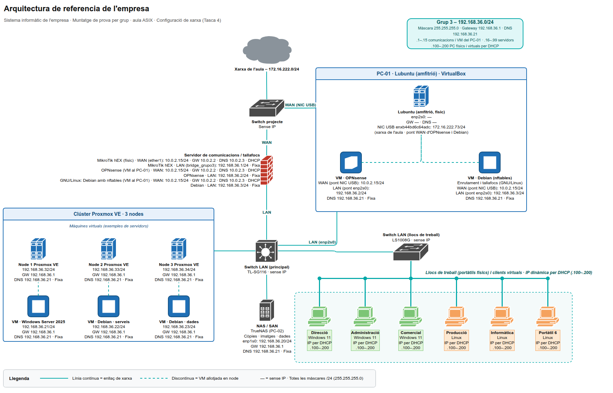

# ASIX ThinkLab · parte individual

**Álex Soler Ruiz** · 1º ASIX · FDM e ISO · curso 2026-27

Mi entorno de pruebas individual: la misma empresa que montamos en grupo en el aula (comunicaciones, NAS de copias, clúster Proxmox, dominio, servidores Linux y clientes), pero a escala, en VirtualBox y sobre el SSD que llevo a clase.

Todas las máquinas son VMs independientes de VirtualBox en el grupo `ASIX-ThinkLAB Individual`. Los tres nodos Proxmox están solo para demostrar el clúster (red + quórum + una prueba de migración medida); los servidores que dan servicio (DC, serveis y dades) no van dentro de ellos, porque VMs dentro de VMs dentro de VirtualBox son lentas y difíciles de mantener.



## Tareas

| Tarea | Documento | Qué hay |
|---|---|---|
| 0 · Entorno | [docs/tarea0-entorno.md](docs/tarea0-entorno.md) | Equipo, VMs, recursos y problemas resueltos |
| 2 · Equipos | [docs/tarea2-equipos.md](docs/tarea2-equipos.md) | Inventario de clase y de casa, tests de memoria, disco y red |
| 4 · Red | [docs/tarea4-red.md](docs/tarea4-red.md) | Esquema, direcciones y pruebas de conectividad |
| 5 · Instalación | [docs/tarea5/](docs/tarea5/README.md) | Routers, TrueNAS, Proxmox, Windows Server, servidores Linux, clientes y copias |
| 6 · RAID | [docs/tarea6-raid.md](docs/tarea6-raid.md) | RAID 0, 1 y 5 con pruebas de fallo y espejo DRBD entre dos equipos |
| 7 · Rendimiento | [docs/tarea7-rendimiento.md](docs/tarea7-rendimiento.md) | Medidas por bloques de VMs, límites del equipo y optimizaciones |

Los PDF de entrega se generan con [pdf/generar-pdf.py](pdf/generar-pdf.py) a partir de estos mismos Markdown.

## Estructura

```
docs/         documentación por tarea (Markdown)
scripts/      todo lo que he automatizado (PowerShell y bash), reutilizable
configs/      configuraciones exportadas de los routers (sin contraseñas)
evidencias/   salidas de comandos, por tarea
capturas/     capturas de pantalla de las consolas y las interfaces web
diagramas/    esquema de red en draw.io (el del grupo con mis IPs: red-individual.drawio y su PNG) y el del grupo
```

## Red en una línea

LAN `192.168.36.0/24` (red interna `lan_grupo3`), dominio `alexsoler.lan`, MikroTik .1 como puerta de enlace y DHCP, OPNsense .2 y Debian/nftables .3 como alternativas, TrueNAS .20, DC .21, serveis .22, dades .23, Proxmox .32-.34 (durante la prueba de migración: contenedor .30 y VM .40).

## Credenciales

No hay ninguna contraseña en el repositorio. Los scripts las piden por variable de entorno (`CLAVE`) y las reales están en un fichero aparte que no se sube.
