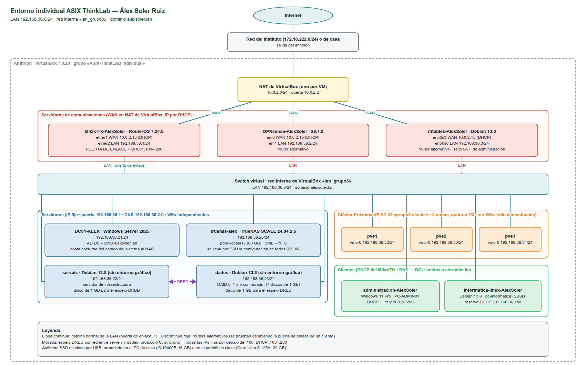

# Tarea 0 · Mi entorno de pruebas

**Álex Soler Ruiz** · 1º ASIX · ASIX ThinkLab (parte individual)

## Qué he montado y dónde

El entorno individual simula, a escala, lo mismo que montamos en grupo en el aula: tres servidores de comunicaciones, un NAS, un clúster Proxmox de tres nodos, un controlador de dominio y clientes Windows y Linux. Todo corre en VirtualBox 7.0.20 sobre el SSD de clase (el mismo disco que llevo al instituto), conectado por USB. Ese SSD lo arranco en dos equipos: el PC de casa (abajo) y el portátil de clase (ASUS ExpertBook, Core Ultra 5 125H, 32 GB), que está en la [Tarea 2](tarea2-equipos.md). Las últimas pruebas, del 23/11, son del portátil.

| | Equipo anfitrión |
|---|---|
| Placa | Gigabyte H470M DS3H (UEFI F3) |
| CPU | Intel Core i5-10400F · 6 núcleos / 12 hilos · VT-x con EPT |
| RAM | 16 GB DDR4 (15,5 GiB útiles) + 8 GB de swap en fichero + zram |
| Disco del sistema | Kingston SA400 480 GB **por USB 3.0** (puente JMicron JMS578, 5 Gbit/s, UAS) |
| SO | Linux Mint 22.3 (base Ubuntu 24.04), kernel 6.8 |
| Hipervisor | VirtualBox 7.0.20 + Extension Pack |

En VirtualBox las máquinas están en el grupo **ASIX-ThinkLAB Individual**, separadas de las del grupo de clase.

## Esquema



La idea es la misma que en el aula, pero sin hardware:

- La "red del aula" (172.16.222.0/24) la sustituye el **NAT de VirtualBox**: cada router tiene su WAN en NAT y coge IP por DHCP (10.0.2.15). El enunciado lo permite para el entorno individual.
- El switch del grupo es la **red interna de VirtualBox `lan_grupo3`**. Todo lo que cuelga de ella está en **192.168.36.0/24**, la red que me corresponde en la parte individual. Al principio lo monté en la 192.168.30.0/24 (la del grupo) y el 23/11 lo cambié todo ([Tarea 4](tarea4-red.md)).
- Los tres routers están en la misma LAN con IPs distintas (.1, .2 y .3). Solo el MikroTik hace de puerta de enlace y DHCP; los otros dos están conectados pero se prueban de uno en uno cambiando la puerta de enlace del cliente de prueba. Así los tres se comparan en el mismo escenario.

## Máquinas y recursos

| VM | Función | SO | vCPU | RAM | Disco | Red |
|---|---|---|---|---|---|---|
| Mikrotik-AlexSoler | Router principal, DHCP | RouterOS 7.24.6 (x86) | 2 | 256 MB | 10 GB | NAT + lan_grupo3 |
| OPNsense-AlexSoler | Cortafuegos alternativo | OPNsense 26.7.9 (FreeBSD 15.1) | 2 | 2 GB | 10 GB | NAT + lan_grupo3 |
| nftables-AlexSoler | Router GNU/Linux | Debian 13.8 + nftables | 2 | 1 GB | 20 GB | NAT + lan_grupo3 |
| truenas-AlexSoler | NAS / copias | TrueNAS SCALE 24.04.2.5 | 2 | 2,5 GB | 16 GB + 60 GB | lan_grupo3 |
| ws-dc-AlexSoler | Controlador de dominio | Windows Server 2025 Standard | 2 | 4 GB | 50 GB | lan_grupo3 |
| clusterProxMox-pve1/2/3 | Nodos del clúster (solo red + clúster, sin máquinas dentro) | Proxmox VE 9.2.32 | 2 c/u | 2 GB c/u | 20 GB c/u | lan_grupo3 |
| serveis-AlexSoler | Servidor de infraestructura | Debian 13 sin entorno gráfico | 1 | 1 GB | 10 GB + 1 GB (DRBD) | lan_grupo3 |
| dades-AlexSoler | Servidor de datos: RAID y espejo | Debian 13 sin entorno gráfico | 1 | 1 GB | 10 GB + 7 × 1 GB (RAID) + 1 GB (DRBD) | lan_grupo3 |
| administracion-AlexSoler | Cliente Windows (Administración) | Windows 11 Pro 23H2 | 2 | 4 GB | 80 GB | lan_grupo3 |
| informatica-linux-AlexSoler | Cliente Linux (Informática) | Debian 13.8 GNOME | 2 | 2 GB | 20 GB | lan_grupo3 |

Si sumo la RAM que tenían asignada las máquinas al principio (DC 8 GB, TrueNAS 8 GB, MikroTik 4 GB, OPNsense 4 GB, Debian 2 GB, tres nodos de 2 GB y el Windows 11 con 4 GB) salen **36 GB para un equipo de 16**. Es imposible tenerlo todo encendido a la vez, así que trabajo por bloques (ver [Tarea 7](tarea7-rendimiento.md)):

| Bloque de trabajo | Máquinas encendidas |
|---|---|
| Comunicaciones | MikroTik + OPNsense + Debian + TrueNAS (5,8 GB asignados) |
| Dominio | MikroTik + Debian + DC + TrueNAS, o DC + Windows 11 apagando TrueNAS: el DC y el Windows 11 (4 GB cada uno) no caben con todo lo demás |
| Virtualización | MikroTik + Debian (salto SSH) + TrueNAS + pve1-3 (9,8 GB asignados). Las máquinas de prueba de la migración solo existieron durante la prueba |
| Servidores Linux | MikroTik + Debian + TrueNAS + serveis + dades (5,75 GB asignados) |

## Cómo administro las máquinas

- **Desde el anfitrión**: `VBoxManage` para arrancar sin pantalla (`--type headless`), hacer capturas y snapshots.
- **Por SSH**: el router Debian hace de "salto" hacia la LAN interna. En su nftables añadí una regla que solo acepta SSH por la WAN si viene de 10.0.2.2, que en el NAT de VirtualBox es el propio anfitrión. Con `ssh -J` o con túneles `-L` llego a la web de TrueNAS, OPNsense o Proxmox.
- **Guest Additions** (`VBoxManage guestcontrol`) en Windows y Debian para lanzar scripts.
- Las credenciales están en un fichero aparte, **fuera del repositorio**.

## Problemas que me he encontrado y cómo los resolví

| Problema | Causa | Solución |
|---|---|---|
| El DC no tenía nada instalado (disco de 404 KB) | La VM estaba creada pero la instalación nunca se llegó a hacer | Instalación desatendida de Windows Server 2025 con `VBoxManage unattended` |
| El DC no arrancaba: *No bootable option or device was found* | Con firmware EFI la ISO de Windows pide "pulsa una tecla para arrancar desde CD"; sin pantalla nadie la pulsa y pasa al disco vacío | Reiniciar y mandar pulsaciones con `keyboardputscancode` durante el arranque |
| El cliente Debian no arrancaba la instalación con EFI | La ISO auxiliar que genera VirtualBox para Debian usa isolinux (solo BIOS) | Cambiar el firmware de esa VM a BIOS |
| Tres servidores DHCP en la misma LAN | MikroTik, dnsmasq del Debian y dnsmasq del OPNsense repartían IPs con puertas de enlace distintas | Solo el MikroTik da DHCP; en los otros dos lo desactivé (en el Debian dejé las líneas comentadas por si pasa a ser el principal) |
| La configuración de dnsmasq estaba repetida | Las mismas líneas en `dnsmasq.conf` y en `dnsmasq.d/lan.conf` (se ve en el historial varios `dnsmasq --test`) | Dejar `dnsmasq.conf` original y toda la configuración propia en `lan.conf` |
| TrueNAS siempre arrancaba el instalador | La ISO seguía montada y el orden de arranque ponía el DVD antes que el disco | Expulsar la ISO y arrancar desde disco |
| Amplié el disco de datos de TrueNAS y seguía viendo 20 GB | Había hecho un snapshot: la VM usa una imagen diferencial y yo amplié la imagen base | Redimensionar la imagen diferencial (la que sale en `showvminfo`) |
| La consola de TrueNAS se quedaba congelada y el apagado colgado | Controlador gráfico VMSVGA con el framebuffer de TrueNAS | Administrarlo por la API REST/SSH; apagado forzado solo cuando no había pool creado |
| En la consola de OPNsense salían otros símbolos (`/` → `-`) | El teclado de la consola estaba en español | `kbdcontrol -l us` |
| OPNsense iba una hora adelantado | VirtualBox pasa el reloj en hora local y FreeBSD lo espera en UTC | `VBoxManage modifyvm --rtc-use-utc on` |
| `apt update` daba error 401 en Proxmox | Repositorio *enterprise* activado sin suscripción | Desactivarlo y añadir `pve-no-subscription` |
| Las tildes de los usuarios del dominio salían rotas | PowerShell 5.1 lee los `.ps1` en UTF-8 sin BOM como ANSI | Guardar los scripts con BOM |
| `sssd` no arrancaba tras unir el Linux al dominio | Varios reinicios seguidos con `realm permit` → *start-limit-hit* | `systemctl reset-failed sssd` y arrancarlo |
| `grub-pc` no se configuraba al actualizar pve2 y pve3 | Los discos son clones/snapshots y cambió su número de serie; GRUB apuntaba al antiguo | Apuntar `grub-pc/install_devices` al disco actual (lo hace ahora [pve-01-nodo.sh](../scripts/pve-01-nodo.sh)) |
| La actualización de pve1 se quedaba parada | Con un solo nodo encendido no hay quórum y `/etc/pve` es de solo lectura | Encender un segundo nodo |
| Las VMs dentro de Proxmox no salían de su nodo | VirtualBox no entrega tramas a MAC que no son la de la tarjeta | `--nicpromisc1 allow-all` en los tres nodos mientras duró la prueba |
| dades (cuando estaba dentro de Proxmox) se quedó en `io-error` y una migración en vivo falló | Thin pool `local-lvm` de 6,8 GB lleno: había asignado más de lo que existe | Mover los discos al NFS y migrar en frío; al final saqué serveis y dades a VMs independientes ([Tarea 5](tarea5/06-proxmox.md)) |
| Las VMs iban a 1,4–4 MB/s por el MikroTik | Su VM tenía tarjetas AMD PCnet emuladas | Cambiarlas a Intel PRO/1000: ×9 ([Tarea 7](tarea7-rendimiento.md)) |
| Desde serveis y dades las descargas se quedaban paradas (y el instalador de Debian se colgaba) | Tarjeta **virtio** en la red interna de VirtualBox | Cambiarla a Intel 82540EM, como el resto: la descarga pasó a 1,7 s ([Tarea 4](tarea4-red.md)) |
| La LAN estaba en la red equivocada (192.168.30.0/24) | Copié el direccionamiento del grupo | Cambiar los 12 equipos a 192.168.36.0/24 sin reinstalar ([Tarea 4](tarea4-red.md)) |
| El PC se colgó entero | No quedó ningún error en el registro; mi hipótesis es el SSD USB atascado con varias VMs escribiendo a la vez | Trabajar por bloques, con una sola carga de disco pesada a la vez ([Tarea 7](tarea7-rendimiento.md)) |
| El MikroTik avisa de licencia | Es la ISO x86 sin licencia (modo demo 24 h) | Para el laboratorio basta; para algo estable usaría CHR (licencia gratuita limitada a 1 Mbit/s) o una licencia nivel 4 |

## Punto de retorno

Antes de tocar nada hice un snapshot de todas las máquinas (`estado-inicial-22nov`). Si un cambio sale mal, vuelvo a ese estado en segundos. Más adelante, en la [Tarea 5](tarea5/README.md), explico las copias de verdad, que están en el NAS y no dependen de VirtualBox.

Ojo con una cosa que aprendí por las malas: con un snapshot hecho, la VM escribe en una **imagen diferencial**. Si amplías el disco base, la VM no ve el cambio (me pasó con TrueNAS), y los discos clonados o con snapshot cambian de número de serie (me pasó con GRUB en Proxmox).

## Documentación en Markdown y Git

Todo este trabajo está en un repositorio Git (`asix-thinklab-individual`), con un commit por cada bloque de trabajo, preparado para publicarlo en GitHub (`git remote add origin …` + `git push`):

```
README.md       portada y mapa del repositorio
docs/           un Markdown por tarea (la Tarea 5, uno por sistema)
scripts/        todo lo que he automatizado: PowerShell (DC, Windows 11) y bash (Proxmox, NAS, RAID, DRBD, medidas)
configs/        configuraciones exportadas de los routers, sin contraseñas
evidencias/     salidas de comandos y capturas, una carpeta por tarea
diagramas/      el esquema de red en draw.io (.drawio), su PNG/SVG y el script que lo genera
pdf/            el script que genera los PDF de entrega a partir de los Markdown
```

- Los PDF de entrega no se escriben aparte: se generan desde estos mismos Markdown ([generar-pdf.py](../pdf/generar-pdf.py)), así nunca hay dos versiones distintas.
- **Las contraseñas no están en el repositorio.** Los scripts las leen de variables de entorno (`CLAVE`, `CLAVE_INICIAL`, `CLAVE_NAS`) y el `.gitignore` bloquea ficheros de credenciales y claves privadas. Antes de cada commit lo compruebo buscando las contraseñas reales con `grep`.
- El esquema está en **draw.io** ([red-individual.drawio](../diagramas/red-individual.drawio)): se abre y se edita en app.diagrams.net o en draw.io Desktop. Lo genero con un pequeño script ([generar-diagrama.py](../diagramas/generar-diagrama.py)) que escribe el `.drawio` y un SVG con la misma geometría. Así, cuando cambié la red a 192.168.36.0/24, actualicé las IPs en un solo sitio, y en Git se ve qué cambió de una versión a otra, cosa que con una imagen no pasa.
