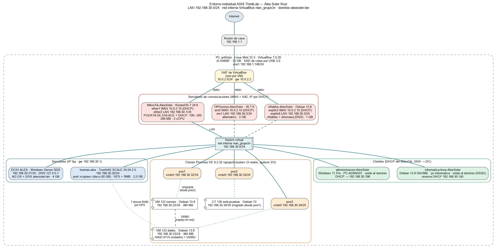

# Tarea 4 · Esquema y red individual



Fuente editable del esquema: [red-individual.dot](../diagramas/red-individual.dot) (Graphviz). El esquema del grupo, para comparar: [arquitectura-grupo3.png](../diagramas/arquitectura-grupo3.png).

## Montaje en VirtualBox

| En el aula | En mi entorno |
|---|---|
| Red del rack 172.16.222.0/24, IP de WAN que asigna el profesor | **NAT de VirtualBox**: cada router coge 10.0.2.15/24 por DHCP, con puerta 10.0.2.2. El enunciado lo permite ("la WAN pot obtindre la IP per DHCP… millor NAT") |
| Switch del grupo | **Red interna `lan_grupo3`**: solo la ven las VMs conectadas a ella, no sale a la red de casa |
| LAN del grupo 3 | **192.168.30.0/24**, el mismo direccionamiento que en clase |

¿Por qué NAT y no adaptador puente? Con un puente los routers estarían en la red de casa y su DHCP podría repartir IPs a otros dispositivos. Con NAT la LAN queda aislada: lo que sale lo hace a través del router y del NAT del anfitrión.

## Direccionamiento y método de asignación

| Equipo | Interfaz | IP / máscara | Puerta | DNS | Asignación |
|---|---|---|---|---|---|
| MikroTik | ether1 WAN | 10.0.2.15/24 | 10.0.2.2 | 1.1.1.1, 8.8.8.8 | DHCP (NAT) |
| | ether2 LAN | **192.168.30.1/24** | — | — | Estática |
| OPNsense | em0 WAN / em1 LAN | 10.0.2.15/24 / **192.168.30.2/24** | 10.0.2.2 | — | DHCP / estática |
| Debian nftables | enp0s3 WAN / enp0s8 LAN | 10.0.2.15/24 / **192.168.30.3/24** | 10.0.2.2 | — | DHCP / estática |
| TrueNAS | enp0s3 | 192.168.30.20/24 | .1 | .1, 1.1.1.1 | Estática |
| DC01-ALEX | LAN | 192.168.30.21/24 | .1 | 127.0.0.1, .1 | Estática |
| serveis | eth0 | 192.168.30.22/24 | .1 | .21, .1 | Estática (cloud-init) |
| dades | eth0 | 192.168.30.23/24 | .1 | .21, .1 | Estática (cloud-init) |
| CT web-pruebas | eth0 | 192.168.30.30/24 | .1 | .1 | Estática |
| pve1 / pve2 / pve3 | vmbr0 | 192.168.30.32 / .33 / .34 /24 | .1 | .1 | Estática |
| PC-ADMIN01 (Windows 11) | Ethernet | 192.168.30.198/24 | .1 | .21, .1 | DHCP |
| pc-informatica (Debian) | enp0s3 | 192.168.30.150/24 | .1 | .21, .1 | DHCP con reserva por MAC |

- **DHCP**: solo el MikroTik, rango .100–.200, entrega puerta .1, DNS .21 (DC) y .1, y el dominio `alexsoler.lan`. Las IPs fijas van por debajo de .100 para que no choquen.
- Al principio había **tres DHCP** en la misma LAN (MikroTik, dnsmasq del Debian y el de OPNsense), y cada uno daba una puerta de enlace distinta. Dejé solo el del MikroTik.
- **Separación**: la LAN solo sale por los routers, que hacen NAT y filtran (bloqueo de telnet y SMB hacia fuera, con registro). Desde fuera no se entra en la LAN salvo el SSH de administración por el router Debian, limitado a la IP del anfitrión (10.0.2.2).
- Los tres routers están en la misma LAN, pero solo el MikroTik es la puerta de enlace. Los otros dos los probé cambiando la puerta de enlace de un cliente (TrueNAS) a .2 o .3.

## Conectividad comprobada

En cada máquina ejecuté lo mismo: interfaces, tabla de rutas, DNS, ping a la puerta de enlace, al NAS, al DC y a Internet, y traceroute a 1.1.1.1. Todo en [red-por-maquina.txt](../evidencias/tasca4/red-por-maquina.txt).

| Origen | Puerta (.1) | NAS (.20) | DC (.21) | Internet (1.1.1.1) | Traceroute |
|---|---|---|---|---|---|
| pve1, pve2, pve3 | ✔ | ✔ | (DC apagado en ese bloque) | ✔ | .1 → 10.0.2.2 → … |
| serveis, dades | ✔ | ✔ | (DC apagado) | ✔ | .1 → 10.0.2.2 → … |
| TrueNAS | ✔ | — | (DC apagado) | ✔ | .1 → 10.0.2.2 → … |
| CT web-pruebas | — | — | — | ✔ | — |
| Router Debian | ✔ | — | — | ✔ | — |
| MikroTik | — | — | — | ✔ (`/ping`, 11 ms) | 10.0.2.2 → 192.168.1.1 → 10.0.1.119 (`/tool traceroute`) |
| DC01-ALEX | ✔ | ✔ | ✔ | ✔ | .1 → 10.0.2.2 → * → 10.0.1.119 |
| pc-informatica (Debian) | ✔ | ✔ | ✔ | ✔ | .1 → 10.0.2.2 → * → 10.0.1.119 |
| PC-ADMIN01 (Windows 11) | ✔ | ✖ (TrueNAS apagado en ese bloque para que cupiera el W11) | ✔ | ✔ | .1 → 10.0.2.2 → * → 10.0.1.119 |

Cómo leo el traceroute: el primer salto es siempre la puerta de enlace de la LAN (192.168.30.1, el MikroTik); el segundo, 10.0.2.2, es el NAT de VirtualBox, o sea, el anfitrión. A partir de ahí ya es la red de casa (el salto 3 no responde a traceroute) e Internet.

Tabla de rutas típica (pve1):

```
default via 192.168.30.1 dev vmbr0 proto kernel onlink
192.168.30.0/24 dev vmbr0 proto kernel scope link src 192.168.30.32
```

Y la del MikroTik, que es el que une las dos redes:

```
DAd  0.0.0.0/0        10.0.2.2       (ruta por defecto aprendida por DHCP en ether1)
DAc  10.0.2.0/24      ether1
DAc  192.168.30.0/24  ether2
```

Los clientes del dominio también resuelven `alexsoler.lan` y el registro SRV del DC y se unen al dominio ([Tarea 5 · clientes](tarea5/09-clientes.md)).

## Recursos simultáneos

La tabla de máquinas con vCPU, RAM, disco y host está en la [Tarea 0](tarea0-entorno.md). El cálculo de cuántas caben a la vez, en la [Tarea 7](tarea7-rendimiento.md): con 16 GB no puedo tener todo encendido, así que trabajo por bloques y dejo unos 3 GB para el anfitrión.
