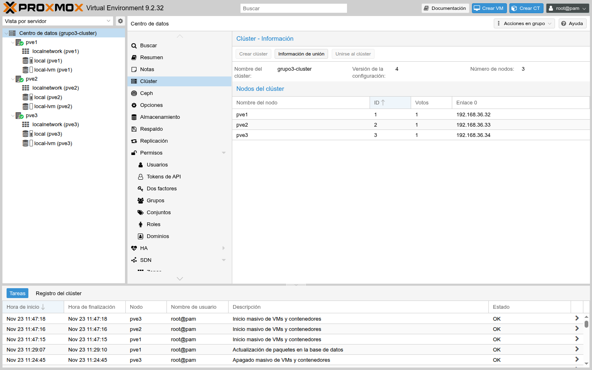
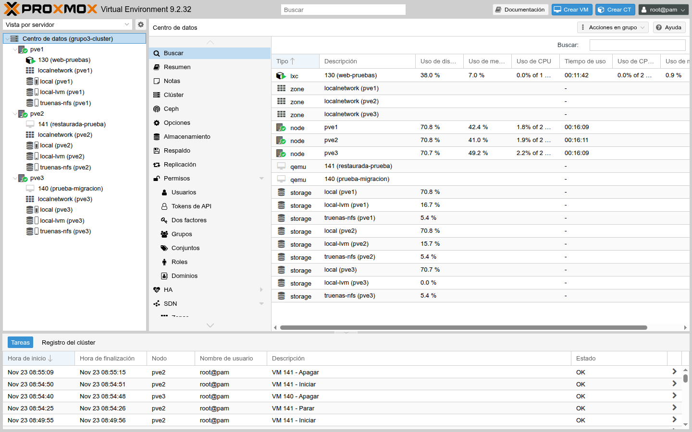
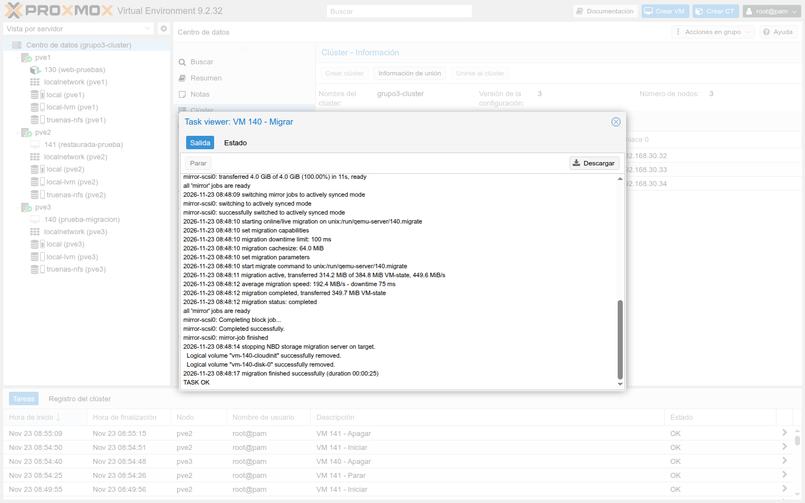
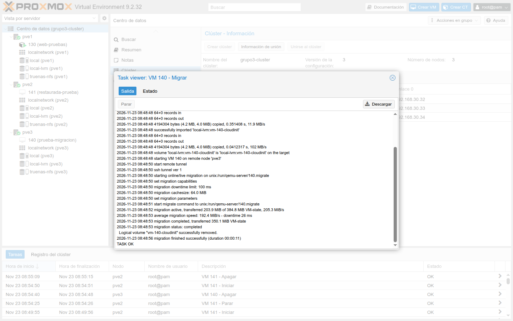
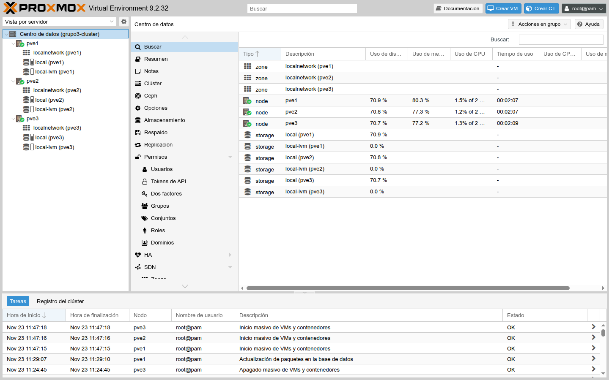

# Proxmox VE · clúster de tres nodos

En mi entorno individual los tres nodos están para una cosa: **demostrar que el clúster funciona**. Las máquinas que dan servicio (serveis, dades y el DC) son VMs independientes de VirtualBox, porque tener máquinas dentro de máquinas que a su vez van dentro de VirtualBox es lento y difícil de mantener (lo comprobé: ver la primera prueba más abajo). Por eso los nodos se quedan **solo con su red y el clúster**. Para la migración creé máquinas de prueba, medí y las borré.

## Instalación, versión y actualización

- Imagen `proxmox-ve_9.2-1.iso`, **SHA-256 verificado** (coincide con la web de Proxmox).
- Tres VMs de VirtualBox (pve1, pve2, pve3) con 2 vCPU, 2 GB de RAM, disco de 20 GB y **virtualización anidada activada** (`nested-hw-virt on`), que hace falta para poder arrancar una VM de prueba dentro.
- El clúster lo creé desde la interfaz web (`https://192.168.36.32:8006` → Centro de datos → Clúster → Crear clúster, y en pve2 y pve3 → Unirse al clúster con la información de unión).
- Antes de usarlos los actualicé ([pve-01-nodo.sh](../../scripts/pve-01-nodo.sh)):

| | Antes | Después |
|---|---|---|
| pve-manager | 9.2.2 | **9.2.32** |
| Kernel | 7.0.2-6-pve | **7.0.14-30-pve** (reinicié los nodos uno a uno) |
| Repositorio | *enterprise* (error 401 sin suscripción) | `pve-no-subscription` |

## Usuarios de administración

- `root@pam`: solo para lo que lo exige (unirse al clúster, consola).
- `alexsoler@pve`: mi cuenta, en el grupo `administradores` con el rol *Administrator* sobre `/`. Como está en `/etc/pve`, vale para los tres nodos ([pve-02-cluster.sh](../../scripts/pve-02-cluster.sh)). Comprobado al final: `acl:1:/:@administradores:Administrator:` ([proxmox-limpieza-nodos.txt](../../evidencias/tasca5/proxmox-limpieza-nodos.txt)).

## Red

| Nodo | Interfaz | IP | Puerta | Puente |
|---|---|---|---|---|
| pve1 | vmbr0 (sobre la tarjeta de `lan_grupo3`) | 192.168.36.32/24 | 192.168.36.1 | vmbr0 |
| pve2 | vmbr0 | 192.168.36.33/24 | 192.168.36.1 | vmbr0 |
| pve3 | vmbr0 | 192.168.36.34/24 | 192.168.36.1 | vmbr0 |

Las VMs y contenedores se conectan a `vmbr0`, así que quedan en la misma LAN que el resto. DNS: el DC (.21) y el MikroTik (.1), con búsqueda `alexsoler.lan`.

**Cambio de red con el clúster ya creado** (23/11): pasé los tres nodos de la 192.168.30.0/24 a la 192.168.36.0/24 sin rehacer el clúster. Con los tres encendidos y con quórum cambié las direcciones `ring0_addr` en `/etc/pve/corosync.conf` y subí `config_version` de 3 a 4 (Proxmox copia ese fichero a los tres nodos). Después, en cada nodo: `interfaces` y `/etc/hosts`, `ifreload -a` y reiniciar corosync. A los 45 s volvía a tener `Quorate: Yes` con los tres nodos en la red nueva. Faltaban dos detalles: el certificado de la web lleva la IP dentro (`pvecm updatecerts --force`) y `/etc/pve/priv/known_hosts` guardaba las IPs viejas (`ssh-keygen -R` no funciona sobre el sistema de ficheros del clúster, así que lo reescribí). Detalle en [cambio-red-192.168.36.txt](../../evidencias/tasca4/cambio-red-192.168.36.txt).

**Problema que tuve**: las VMs creadas dentro de Proxmox hacían ping a su nodo pero no al MikroTik. VirtualBox, en una red interna, solo entrega a cada tarjeta las tramas dirigidas a **su** MAC, y las VMs anidadas tienen MAC propias (`BC:24:11:…`). Hay que poner la tarjeta del nodo en modo promiscuo (`VBoxManage modifyvm clusterProxMox-pveN-AlexSoler --nicpromisc1 allow-all`). Lo activé solo mientras duraron las pruebas y al terminar lo volví a dejar en `deny`, porque sin VMs dentro no hace falta.

## Clúster


*Centro de datos → Clúster, después del cambio de red: `grupo3-cluster`, tres nodos con un voto cada uno en 192.168.36.32–.34 y la versión de configuración 4.*

- `grupo3-cluster`, transporte *knet*: **quórum = 2 de 3**. `pvecm status` → `Nodes: 3`, `Quorate: Yes`.
- Lo comprobé sin querer: con solo pve1 encendido no hay quórum, `/etc/pve` queda en solo lectura y la actualización se quedó parada en `systemctl reload-or-restart pvescheduler`. En cuanto arrancó pve2 (2 votos) siguió sola.
- **Gestión conjunta, migración y alta disponibilidad no son lo mismo**: el clúster me deja administrar los tres nodos desde cualquiera y mover máquinas entre ellos. La alta disponibilidad (HA) además las rearrancaría solas en otro nodo si uno cae, pero para eso los discos tienen que estar en almacenamiento compartido. No la he activado.

## Prueba de migración (23/11, máquinas solo de prueba)

Script: [pve-06-prueba-migracion.sh](../../scripts/pve-06-prueba-migracion.sh). Salida completa: [proxmox-migraciones.txt](../../evidencias/tasca5/proxmox-migraciones.txt). La prueba es de antes del cambio de red, así que en esa salida y en las capturas de las migraciones las IPs aún son 192.168.30.x (mismo último octeto).

- **CT 130 `web-pruebas`**: contenedor LXC Debian 13, 256 MB, 2 GB de disco, IP .30.
- **VM 140 `prueba-migracion`**: Debian 13 sin entorno gráfico (imagen oficial `debian-13-generic-amd64.qcow2` comprobada con su `SHA512SUMS`), 384 MB, 4 GB de disco, IP .40.

Mientras migraba, pve3 hacía `ping` cada 0,5 s a la máquina, así veo el corte real y no solo lo que dice Proxmox.


*Durante la prueba: el contenedor en pve1, la VM en pve3 y la VM restaurada desde la copia en pve2.*

| Prueba | Tipo | Qué se copia | Tiempo | Corte medido con ping |
|---|---|---|---|---|
| CT 130 pve2 → pve1 | *restart* (un contenedor LXC no migra en vivo) | El volumen entero: **2,0 GiB** a ~130 MB/s | **26,6 s** | ~23 s (46 pings de 58) |
| VM 140 pve1 → pve2 | **en vivo**, disco local | Disco de **4 GiB** (*drive-mirror*) + **350 MiB** de RAM | **25,3 s** | Proxmox: 75 ms. Ping: ~3,5 s (7 de 56) |
| VM 140 pve2 → pve3 | **en vivo**, disco en el NFS de TrueNAS | Solo **350 MiB** de RAM | **11,7 s** | Proxmox: 26 ms. Ping: 1 de 29 |


*Migración en vivo con disco local: primero copia los 4 GiB del disco y luego la RAM; pausa de la VM de 75 ms.*


*Con el disco en el NAS solo viaja la RAM: 11 s en total y 26 ms de pausa.*

Para pasar de la segunda a la tercera prueba moví el disco de la VM al NFS **sin apagarla** (`qm disk move … truenas-nfs`): 22 s.

### Cómo lo interpreto

- **El contenedor se para**: LXC no puede congelar procesos y llevárselos a otro kernel como hace QEMU con una VM. Proxmox lo apaga, copia el volumen entero (los 2 GiB, aunque solo use unos 700 MB) y lo arranca en el destino. Para un servicio real son 20-25 s sin servicio.
- **En vivo con disco local, el disco es lo que más pesa**: de 25 s, unos 12 son copiando los 4 GiB. Con un disco de 40 GB serían minutos. La VM no se para mientras tanto, pero la red de la LAN y el disco del anfitrión van cargados.
- **Los 75 ms que dice Proxmox y los 3,5 s del ping no coinciden.** Proxmox mide solo la pausa final de la VM; el ping mide lo que nota un usuario. En la migración con disco compartido solo se perdió uno, así que la diferencia tiene que ver con la copia del disco. Mi explicación, que no he podido demostrar porque el ping no guardaba la hora de cada respuesta, es que los tres nodos escriben en el mismo SSD USB y la copia del disco satura el anfitrión. La próxima vez usaría `ping -D` para ver en qué segundo exacto se corta.
- **Con almacenamiento compartido** la migración tarda menos de la mitad y prácticamente no se nota. Es también lo que pide la alta disponibilidad.

### Primera prueba (la noche anterior) y por qué saqué serveis y dades de Proxmox

La primera vez migré la VM de **serveis**, que entonces estaba dentro del clúster con discos de 6 GiB + 1 GiB ([proxmox-migraciones-primera-prueba.txt](../../evidencias/tasca5/proxmox-migraciones-primera-prueba.txt)):

| Prueba | Resultado |
|---|---|
| CT 130 pve1 → pve2 | Correcta en 24 s (2 GiB) |
| VM serveis en vivo con discos locales | **Falló a los 1 min 40 s**: la copia escribe también los ceros, 7 GiB no caben en el *thin pool* de 6,78 GiB del nodo destino y Proxmox la canceló. La VM siguió funcionando en el origen sin perder un ping |
| VM serveis en frío | Correcta en 44 s + 5 s de apagado (en frío sí respeta los huecos) |

Esa noche el *thin pool* se llenó dos veces (también con dades y sus discos de RAID). Con nodos de 2 GB de RAM y 7 GB de disco no se pueden tener servidores de verdad dentro. Por eso **serveis y dades pasaron a ser VMs independientes de VirtualBox**, igual que el DC, y los nodos se quedan para demostrar el clúster.

### Mejoras que haría

1. **Discos en almacenamiento compartido** (NFS de TrueNAS o Ceph). Lo he medido: de 25,3 s a 11,7 s y sin corte apreciable.
2. **Red de migración separada** de la LAN de usuarios, para que copiar un disco no frene al resto.
3. **No sobreasignar el thin pool**, o vigilarlo con una alerta al 80 %.

## Copias de configuración e imágenes

| Qué | Dónde | Cómo | Por qué |
|---|---|---|---|
| `/etc/pve`, `/etc/network/interfaces`, corosync y `config.db` de cada nodo | `copias/configs` del NAS | El NAS se lo lleva por SSH cada noche ([copias-config.sh](../../scripts/copias-config.sh)) | Con eso se reconstruye un nodo: instalar Proxmox desde la ISO y devolverle su configuración |
| Imágenes de VMs y contenedores (`vzdump`) | NFS de TrueNAS | Lo probé con las máquinas de prueba (abajo) | En un clúster con máquinas de verdad sería una tarea diaria a las 22:00. Ahora los nodos no tienen máquinas, así que no hay nada que copiar |
| **No** copio el sistema de los nodos | — | — | Proxmox se reinstala desde la ISO en unos 10 minutos (estimado); lo que vale es la configuración |

Prueba de copia y **restauración** (una copia que no se ha restaurado nunca no demuestra nada):

| Máquina | Datos | Fichero en el NAS | Tiempo |
|---|---|---|---|
| VM 140 (encendida, modo *snapshot*) | 4 GiB leídos | **370 MB** (`.vma.zst`) | 12 s |
| CT 130 | ~700 MB | **246 MB** (`.tar.zst`) | 13 s |
| Restaurar la VM 140 como VM 141 en pve2 | 4 GiB, 75 % eran ceros | — | **9,6 s**, y arrancó: respondió al ping en la misma IP a los 16 s, con una MAC nueva |

## Cómo quedan los nodos

Al terminar borré las máquinas de prueba, sus copias, la plantilla y la imagen del NAS, la tarea de copia y el almacenamiento NFS ([pve-07-limpiar.sh](../../scripts/pve-07-limpiar.sh), salida en [proxmox-limpieza-nodos.txt](../../evidencias/tasca5/proxmox-limpieza-nodos.txt)). Me equivoqué dos veces con el script (el `ssh` del bucle se comía el resto del script por la entrada estándar, y pve1 no resolvía por nombre los otros nodos) y lo dejé corregido.


*Estado final, ya en la red nueva: tres nodos con quórum, sin VMs ni contenedores, solo `local` y `local-lvm` (vacío).*

```
Máquinas en el clúster: 0       Tareas de copia: 0
local-lvm  lvmthin  active  0 % usado
pve1: 192.168.36.32 9.2.32 · pve2: 192.168.36.33 9.2.32 · pve3: 192.168.36.34 9.2.32
```
